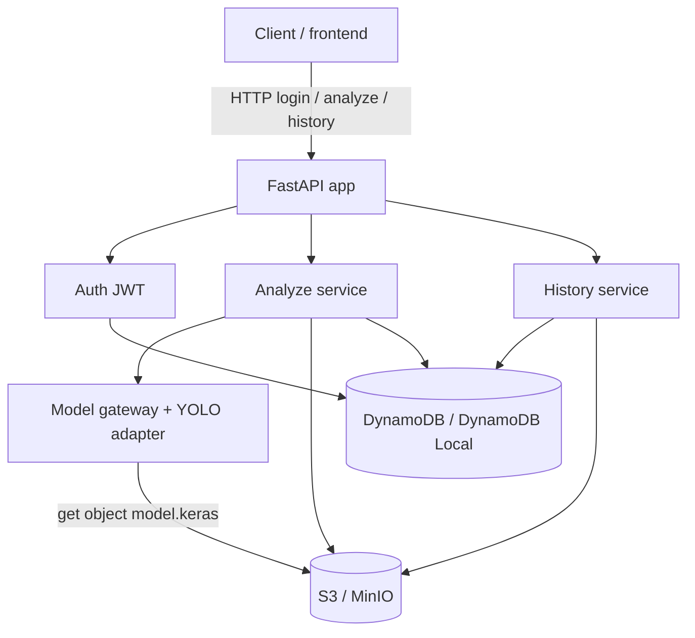

# Sonar Mine Analysis Design

**Spec**: `.specs/features/sonar-mine-analysis/spec.md`
**Context**: `.specs/features/sonar-mine-analysis/context.md`
**Status**: Approved

---

## Architecture Overview

**Chosen approach:** Same FastAPI app talks to **S3-compatible** object storage and **DynamoDB-compatible** metadata via `boto3` (endpoint URLs from env). **Local/dev** runs as **Docker Compose**: `app` + **MinIO** (S3 API) + **DynamoDB Local**. **AWS student deploy** uses the same code against real S3 + DynamoDB on a small EC2 host (`t2.micro` / `t2.small`, typically `us-east-1`). Auth is local JWT for seeded users (AD-002). Inference is synchronous with a 60s hard timeout; the model is fetched from object storage on startup (or first request) and **cached in process memory**.



### Local stack (Docker Compose) — primary day-to-day

| Service | Image (illustrative) | Role |
| ------- | -------------------- | ---- |
| `app` | build from repo `Dockerfile` | FastAPI + uvicorn; mounts or copies code; waits for MinIO/DDB healthy |
| `minio` | `minio/minio` | S3-compatible API + console; bucket created by init job or app bootstrap |
| `minio-init` (optional one-shot) | `minio/mc` | Create bucket, optional seed of `models/.../model.keras` |
| `dynamodb` | `amazon/dynamodb-local` | DynamoDB API on `-inMemory` or shared volume for persistence across restarts |

**Compose networking:** app uses:

- `AWS_ENDPOINT_URL_S3=http://minio:9000` (or `S3_ENDPOINT_URL`)
- `AWS_ENDPOINT_URL_DYNAMODB=http://dynamodb:8000` (or `DYNAMODB_ENDPOINT_URL`)
- Shared dummy creds (`MINIO_ROOT_USER` / `MINIO_ROOT_PASSWORD`, `AWS_ACCESS_KEY_ID` / `AWS_SECRET_ACCESS_KEY`) — **local only**, never production secrets
- `AWS_REGION=us-east-1` (DynamoDB Local expects a region string)

**Why MinIO + DynamoDB Local (not full LocalStack):** smaller surface, closer 1:1 with the two AWS services we use, fewer Educate-irrelevant emulators. LocalStack remains an acceptable substitute if the team already standardizes on it — same env-endpoint pattern.

**Presigned URLs locally:** MinIO supports S3 presign; configure `S3_PUBLIC_ENDPOINT` (e.g. `http://localhost:9000`) so browsers receive host-reachable URLs, not only the Docker-internal hostname.

**Request path (analyze):**

1. JWT middleware resolves `user_id` + `org_id`.
2. Validate content type + size (≤ 10 MB); decode image bytes.
3. Ensure model is loaded; else fetch from S3 → load `.keras` → cache (or raise `MODEL_UNAVAILABLE`).
4. Run inference under a 60s timeout.
5. Map raw output → canonical detections via adapter.
6. Put original image to S3; put analysis item to DynamoDB.
7. Return `200` + analysis payload (including `detections`, possibly `[]`).

---

## Code Reuse Analysis

### Existing Components to Leverage

| Component | Location | How to Use |
| --------- | -------- | ---------- |
| None | greenfield repo | No application code yet — establish layered FastAPI layout as the house pattern |

### Integration Points

| System | Integration Method |
| ------ | ------------------ |
| Object storage (S3 / MinIO) | `boto3` S3 client with optional custom `endpoint_url`; model key + `analyses/{org_id}/{analysis_id}/original.{ext}` |
| Metadata (DynamoDB / DynamoDB Local) | `boto3` resource/client with optional custom `endpoint_url`; single-table (see Data Models) |
| Local Compose | `docker-compose.yml` (+ `Dockerfile`); app depends_on healthy MinIO + DynamoDB Local |
| AWS EC2 host | Same image/process; empty endpoint URLs → real AWS; instance profile or env keys |
| Unit/integration tests | Prefer **moto** (or Testcontainers Compose) against repository interfaces — no real AWS required in CI |

---

## Components

### App / HTTP API

- **Purpose**: Expose REST endpoints and wire dependency injection.
- **Location**: `app/main.py`, `app/api/routes/*.py`, `app/api/deps.py`
- **Interfaces**:
  - `POST /auth/login` — credentials → access token
  - `GET /auth/me` — current user + org (protected smoke)
  - `POST /analyses` — multipart image → sync analysis result
  - `GET /analyses` — list org analyses (`limit`, `offset`)
  - `GET /analyses/{analysis_id}` — detail + image access URL/key
  - `GET /health` — liveness (no auth)
- **Dependencies**: Auth, Analyze, History services; settings
- **Reuses**: n/a (new)

### Settings

- **Purpose**: Load env config (JWT secret, S3 bucket/key, table names, seed admin, timeout).
- **Location**: `app/core/config.py`
- **Interfaces**:
  - `get_settings() -> Settings` — cached pydantic-settings
- **Dependencies**: environment variables
- **Reuses**: n/a

### Auth service

- **Purpose**: Verify seeded users, issue/validate JWT, bind `org_id`.
- **Location**: `app/services/auth.py`, `app/core/security.py`
- **Interfaces**:
  - `authenticate(username: str, password: str) -> TokenPair`
  - `hash_password` / `verify_password`
  - `create_access_token(sub, org_id, role) -> str`
  - `decode_token(token) -> Claims`
  - `bootstrap_platform_admin_from_env()` — ensure env admin exists at startup (optional seed)
- **Dependencies**: User repository (DynamoDB), settings (`JWT_SECRET`, `ACCESS_TOKEN_TTL`, `PLATFORM_ADMIN_*`)
- **Reuses**: n/a

### Analyze service

- **Purpose**: Validate upload, run inference, persist success path.
- **Location**: `app/services/analyze.py`
- **Interfaces**:
  - `analyze_image(org_id, user_id, filename, content_type, data: bytes) -> AnalysisResult`
- **Dependencies**: Model gateway, Detection adapter, Image store (S3), Analysis repository, timeout helper
- **Reuses**: n/a

### Model gateway

- **Purpose**: Fetch `.keras` from S3 and keep a process-local loaded model.
- **Location**: `app/services/model_gateway.py`
- **Interfaces**:
  - `ensure_model_loaded() -> LoadedModel` — raises `ModelUnavailableError`
  - `predict(image_array) -> RawModelOutput`
- **Dependencies**: S3 client, TensorFlow/Keras, settings (`MODEL_S3_URI`)
- **Reuses**: n/a

### Detection adapter

- **Purpose**: Map model-specific tensors to canonical API detections (YOLO-like boxes in pixels + confidence).
- **Location**: `app/services/detection_adapter.py`
- **Interfaces**:
  - `to_detections(raw: RawModelOutput, image_width: int, image_height: int) -> list[Detection]`
- **Dependencies**: canonical schemas only
- **Reuses**: n/a — **swap/extend this module when the real `.keras` head is fixed** without changing API routes

### History service

- **Purpose**: Org-scoped list/get; never leak cross-org ids.
- **Location**: `app/services/history.py`
- **Interfaces**:
  - `list_analyses(org_id, limit, offset) -> Page[AnalysisSummary]`
  - `get_analysis(org_id, analysis_id) -> AnalysisDetail` — missing or wrong org → `404`
- **Dependencies**: Analysis repository, optional presigned URL helper for images
- **Reuses**: n/a

### Repositories (DynamoDB)

- **Purpose**: Persistence for orgs, users, analyses.
- **Location**: `app/repositories/*.py`
- **Interfaces**:
  - `UserRepo.get_by_username`, `put_user`, `ensure_seed_users`
  - `OrgRepo.get`, `ensure_seed_orgs`
  - `AnalysisRepo.put`, `get`, `list_by_org`
- **Dependencies**: boto3 DynamoDB
- **Reuses**: n/a

### Object store (S3 / MinIO)

- **Purpose**: Put/get model and analysis images against any S3 API.
- **Location**: `app/repositories/s3_store.py`
- **Interfaces**:
  - `download_model() -> bytes | path`
  - `put_analysis_image(org_id, analysis_id, ext, data) -> s3_key`
  - `presign_get(key, expires_seconds) -> url` (for GET detail; uses public endpoint when set)
- **Dependencies**: boto3 S3; settings `S3_ENDPOINT_URL`, `S3_PUBLIC_ENDPOINT`, `S3_BUCKET`, path-style addressing **on** for MinIO
- **Reuses**: n/a

### AWS client factory

- **Purpose**: Build boto3 clients once with local vs AWS endpoints.
- **Location**: `app/core/aws.py`
- **Interfaces**:
  - `s3_client() -> botocore client`
  - `dynamodb_resource() -> boto3 resource`
- **Dependencies**: settings (`endpoint_url` None ⇒ default AWS)
- **Reuses**: n/a

### Seed / bootstrap

- **Purpose**: Idempotent seed of orgs + members + platform admin from env/config.
- **Location**: `app/bootstrap/seed.py` (+ optional CLI `python -m app.bootstrap.seed`)
- **Interfaces**:
  - `run_seed()` — creates demo orgs/users if absent
- **Dependencies**: repos, security hashing, settings
- **Reuses**: n/a

---

## Data Models

### Canonical API — Detection

```python
class Detection(BaseModel):
    # xyxy in uploaded-image pixel coordinates; half-open [x1, x2) × [y1, y2)
    x1: float
    y1: float
    x2: float
    y2: float
    confidence: float  # 0..1
    label: str = "mine"  # stable default until multi-class model exists
```

**Choice:** `x1,y1,x2,y2` over `x,y,w,h` — maps cleanly from YOLO corners and is easy for frontend overlays. Corner convention is half-open (inclusive start, exclusive end).

### Analysis (API)

```python
class AnalysisResult(BaseModel):
    id: str
    org_id: str
    user_id: str
    status: Literal["succeeded"]  # MVP success path only for persisted success rows
    detections: list[Detection]
    image_content_type: str
    image_s3_key: str
    image_url: str | None  # presigned GET when returning detail
    created_at: datetime
    inference_ms: int | None
```

### DynamoDB layout (recommended: **single-table**)

**Table:** `narwal` (name via env)

| PK | SK | Entity | Attributes (illustrative) |
| ---- | ---- | ------ | ------------------------- |
| `ORG#<org_id>` | `META` | Organization | `name`, `created_at` |
| `ORG#<org_id>` | `USER#<user_id>` | User | `username`, `password_hash`, `is_platform_admin` |
| `USERNAME#<username>` | `USER` | Username lookup | `user_id`, `org_id` |
| `ORG#<org_id>` | `ANALYSIS#<analysis_id>` | Analysis | `user_id`, `status`, `detections` (list/map), `image_s3_key`, `image_content_type`, `created_at`, `inference_ms` |

**Access patterns:**

- Login: `USERNAME#…` → user → verify hash → JWT(`sub`, `org_id`)
- List analyses: `Query PK=ORG#… begins_with ANALYSIS#` newest-first via `created_at` on items + ScanIndexForward or GSI if needed
- Get analysis: `GetItem PK=ORG#… SK=ANALYSIS#…` (org in PK enforces isolation)

**Optional GSI:** `GSI1PK=ORG#<org_id>, GSI1SK=CREATED#<iso>` if query-by-time is awkward on SK alone. MVP may use `ANALYSIS#<ulid>` (time-sortable) so list is a reverse query on SK.

### S3 key layout

```
s3://{bucket}/
  models/{model_version}/model.keras
  analyses/{org_id}/{analysis_id}/original.{png|jpg}
```

### Auth claims

```python
class TokenClaims(BaseModel):
    sub: str       # user_id
    org_id: str
    role: Literal["member", "platform_admin"]
    exp: int
```

**Relationships:** User belongs to exactly one Org. Analysis belongs to one Org and one User. Image object is referenced by `image_s3_key` only (no DynamoDB binary).

---

## Error Handling Strategy

| Error Scenario | Handling | User Impact |
| -------------- | -------- | ----------- |
| Invalid credentials | `401` `{code: "INVALID_CREDENTIALS"}` | Login fails |
| Missing/invalid JWT | `401` `{code: "UNAUTHORIZED"}` | Call rejected |
| Oversize / bad image type / corrupt bytes | `400` `{code: "INVALID_IMAGE"}`; no DDB/S3 analysis write | Fix upload |
| Model S3 miss / load failure | `503` `{code: "MODEL_UNAVAILABLE"}`; no analysis row | Ops: fix model object |
| Inference timeout (>60s) | `504` `{code: "INFERENCE_TIMEOUT"}`; no success row (P3 failed-row later) | Retry / smaller image |
| S3 put image fails after inference | `503` `{code: "STORAGE_ERROR"}`; no success claim; best-effort no orphan success item | Retry |
| Cross-org analysis id | `404` `{code: "ANALYSIS_NOT_FOUND"}` | No leak |
| Analysis not found in org | `404` `{code: "ANALYSIS_NOT_FOUND"}` | — |

Stable `code` field is mandatory for clients; human `message` is secondary.

---

## Risks & Concerns

| Concern | Location | Impact | Mitigation |
| ------- | -------- | ------ | ---------- |
| Greenfield — no existing patterns | repo root | Inconsistent structure if rushed | Enforce layered layout in Tasks; OpenAPI as contract |
| Keras/TF memory on `t2.micro` | EC2 | OOM / swap thrash / timeout | Prefer `t2.small` when credits allow; load model once; document min instance; consider TF CPU build |
| Student IAM may block some IAM role patterns | AWS account | Deploy friction | Instance profile if allowed; else env keys only on EC2 (document secret handling); least-privilege bucket/table ARNs |
| Model head unknown | `detection_adapter` | Wrong mapping → silent bad boxes | Adapter interface + fixture-based unit tests with fake raw outputs; real model wired late |
| Sync timeout vs cold S3+TF load | analyze path | First request exceeds 60s | Eager load model at startup (`lifespan`); health can expose `model_ready` |
| Presigned URL leakage | history GET | Anyone with URL can fetch image until expiry | Short TTL (e.g. 5–15 min); org check before minting |
| Password seed in env | bootstrap | Secret sprawl | Hash at seed time; never log passwords; `.env` gitignored |
| Single EC2 SPOF | deploy | Downtime for demos | Accept for MVP; stop instance when idle to save credits |
| DynamoDB item size (detections JSON) | AnalysisRepo | Hard 400 KB item limit | Cap detection count in adapter (e.g. top-N) if needed; keep image in S3 only |
| MinIO path-style / presign host mismatch | local Compose | Broken image URLs in browser | `S3_PUBLIC_ENDPOINT=http://localhost:9000` + path-style; document in README |
| DynamoDB Local in-memory data loss | local Compose | Seeds wiped on container recreate | Document re-seed on `compose up`; optional named volume if persistence desired |
| TF image size in Compose | `app` Dockerfile | Slow builds / heavy laptop RAM | Optional `Dockerfile` target without TF for API-only; fake model gateway for smoke; full image for inference demos |
| No AWS MCP in this environment | tooling | Docs verified via web/search only | Flag uncertain Educate-specific quotas as “verify in console” |

---

## Tech Decisions (non-obvious)

| Decision | Choice | Rationale |
| -------- | ------ | --------- |
| Local runtime | Docker Compose: `app` + MinIO + DynamoDB Local | Offline-friendly; mirrors AWS APIs used in prod; no student credits burned while coding |
| S3 stand-in | MinIO | Mature S3 API + console; easy bucket seed with `mc` |
| DynamoDB stand-in | `amazon/dynamodb-local` | Official emulator; same boto3 code paths |
| AWS client config | Optional `endpoint_url` + path-style for MinIO | One codebase for local and AWS |
| Compute (AWS) | EC2 `t2.micro`/`t2.small` + uvicorn | Keras/TF unfit for zip-Lambda; container-Lambda heavier on student IAM/ECR |
| Metadata store | DynamoDB single-table | Available on account; no always-on RDS credits; org PK isolation |
| Object store | One bucket, prefixed keys | Model + images; simple IAM / MinIO policy |
| Auth tokens | JWT (HS256) access token | Stateless; matches “login” story without Cognito |
| Password hashing | bcrypt (passlib or bcrypt lib) | Standard for seeded local users |
| ID generation | ULID (or UUID v7) for `analysis_id` | Time-sortable list under `ANALYSIS#` SK |
| Box schema | `x1,y1,x2,y2` + `confidence` + `label` | YOLO-like, frontend-friendly |
| Image access on GET | Presigned GET (S3/MinIO) | Avoid streaming every image through the API process |
| TIFF | Config flag off by default (P2) | Spec P2 |
| IaC (AWS) | Thin CloudFormation (bucket, table, instance profile) + documented CLI bootstrap | Avoid Terraform state/IAM fights on Educate |
| Tests | pytest + httpx; moto and/or compose profile; fake model gateway | Spec outcomes without real TF in CI if needed |
| API versioning | Unversioned `/…` for MVP | Single consumer (Narwal frontend) |
| Region default | `us-east-1` | Educate + DynamoDB Local convention |

---

## Project layout (target)

```
app/
  main.py
  core/           # config, security, errors, aws client factory
  api/routes/     # auth, analyses, health
  services/       # auth, analyze, history, model_gateway, detection_adapter
  repositories/   # dynamodb, s3
  schemas/        # pydantic API models
  bootstrap/      # seed table + users; ensure bucket
tests/
infra/            # optional CFN templates (AWS only)
docker-compose.yml
Dockerfile
.env.example      # local MinIO/DDB endpoints + seed creds
.specs/features/sonar-mine-analysis/
```

---

## Environment split

| Variable (illustrative) | Local Compose | AWS EC2 |
| ----------------------- | ------------- | ------- |
| `S3_ENDPOINT_URL` | `http://minio:9000` | unset |
| `S3_PUBLIC_ENDPOINT` | `http://localhost:9000` | unset or CloudFront/public S3 URL strategy |
| `S3_FORCE_PATH_STYLE` | `true` | `false` |
| `DYNAMODB_ENDPOINT_URL` | `http://dynamodb:8000` | unset |
| `S3_BUCKET` / `DDB_TABLE` | same names | same names |
| Credentials | MinIO root / static keys | instance profile preferred |

---

## AWS student-account notes

- Day-to-day work stays on **Compose** so credits are not burned.
- Prefer **stop EC2 when not demoing** to conserve credits.
- Confirm in console: DynamoDB on-demand, S3, EC2 instance type quota, ability to attach instance profile (if blocked, use IAM user keys only on the instance — still not in git).
- Do **not** depend on Cognito, RDS, or Marketplace AMIs for MVP.

**Uncertainty:** Exact Educate quotas (max DynamoDB tables, whether instance profiles are allowed) vary by program — **verify in your account** before Tasks that assume an instance profile.
