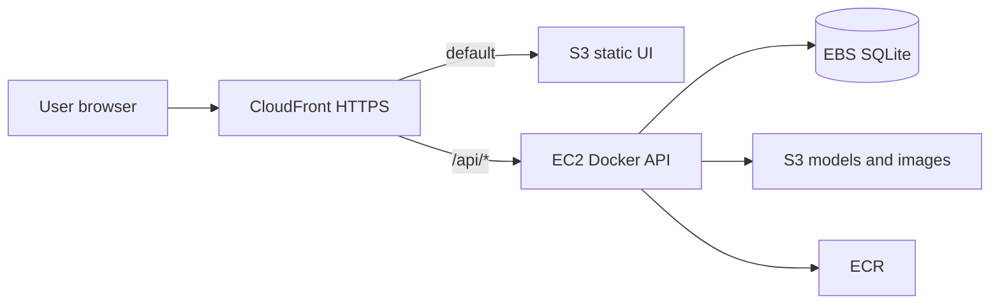

# Narwal AWS architecture (Academy Learner Lab)

This document describes the **target production topology** for Narwal on AWS Academy Learner Lab. It aligns with `.specs/features/aws-academy-deploy/spec.md` and `design.md`.

## Goals

- One **public HTTPS URL** for the TCC demo (CloudFront default domain, e.g. `https://dxxxxxxxx.cloudfront.net`).
- **FastAPI** inference on **EC2** (CPU-only; no GPU in Learner Lab).
- **React** static hosting on **S3** behind the same CloudFront distribution.
- **Reproducible infrastructure** via Terraform in `narwal-backend/infra/` (to be implemented).
- **CI/CD** via GitHub Actions pushing to **ECR** (API) and **S3** (UI).

## High-level diagram

## Component responsibilities

| Component | Role |
| --------- | ---- |
| **CloudFront** | TLS termination; routes `/` to UI bucket; routes `/api/*` to API origin (EC2:8080). |
| **S3 (UI)** | Hosts Vite production build (`index.html`, `/assets/*`). |
| **S3 (app)** | Bucket `narwal` (or equivalent): model `.pt` files, analysis uploads, optional DB backups. |
| **EC2** | Runs Docker image from ECR; `uvicorn` on port 8080; **LabInstanceProfile** for S3 API access. |
| **Elastic IP** | Stable IPv4 for API origin when instance is stopped/started within the lab. |
| **EBS** | Root or data volume holding `SQLITE_PATH` (SQLite metadata). |
| **ECR** | Stores immutable backend images produced by GitHub Actions. |
| **GitHub Actions** | Test, build, push (ECR / S3), deploy, invalidate CloudFront. |

## Application integration

### Backend environment (AWS)

| Variable | Local (MinIO) | AWS |
| -------- | ------------- | --- |
| `S3_ENDPOINT_URL` | `http://localhost:9000` | unset |
| `S3_FORCE_PATH_STYLE` | `true` | `false` |
| `S3_PUBLIC_ENDPOINT` | `http://localhost:9000` | unset or public HTTPS host for presigned URLs |
| `AWS_ACCESS_KEY_ID` | minioadmin | unset (instance profile) |
| `SQLITE_PATH` | `/app/db/narwal.db` (Compose) | `/data/narwal.db` on persistent EBS |
| `FIX_DB_PERMISSIONS` | `1` in `docker-compose.yml` only | **unset** — chown the EBS mount on the host once (`scripts/prepare-sqlite-volume.sh`) |

The container runs the API as **uid 1001** (`appuser`). The SQLite file and its directory must be writable by that uid on the mounted volume.

See `.env.example` in the backend repo for the full list.

### Frontend routing

Development uses Vite proxy (`/api` → `localhost:8080`). In AWS, the **browser origin is CloudFront**, so relative requests like `/api/auth/login` must hit CloudFront and be forwarded to EC2. No change to fetch paths is required if CloudFront behaviors are configured correctly.

## Security notes (lab scope)

- Secrets (`JWT_SECRET`, admin password, `LLM_API_KEY`) live in **EC2 environment** only—not in git or Terraform plaintext.
- GitHub Actions uses **Learner Lab access keys** stored as repository secrets; rotate if leaked.
- Security groups should limit API port exposure where practical; CloudFront is the intended public entry.

## Model runtime and instance sizing

- Default model at startup: **YOLO + ConvNeXt (balanced)** — loads **two YOLO weights and three ConvNeXt classifiers** into memory.
- **Initial instance: `t3.medium` (4 GiB RAM).** If the container OOMs during preload or analyze, resize to **`t3.large` (8 GiB)** in the EC2 console (allowed up to `large` in Learner Lab).
- Switching models in the UI may load **additional** pipelines (cached in `GatewayPool`); full registry testing needs more RAM.

## Out of scope for this architecture

- RDS, ECS/Fargate, API Gateway, App Runner, GPU instances, custom DNS (unless later confirmed in your lab allow list).

## Traceability

| Doc section | Requirements |
| ----------- | ------------ |
| CloudFront + dual origin | DEPLOY-01, DEPLOY-02 |
| ECR + GHA | DEPLOY-09, DEPLOY-11 |
| SQLite on EBS | DEPLOY-08 |
| S3 models/images | DEPLOY-04 (existing app behavior) |
